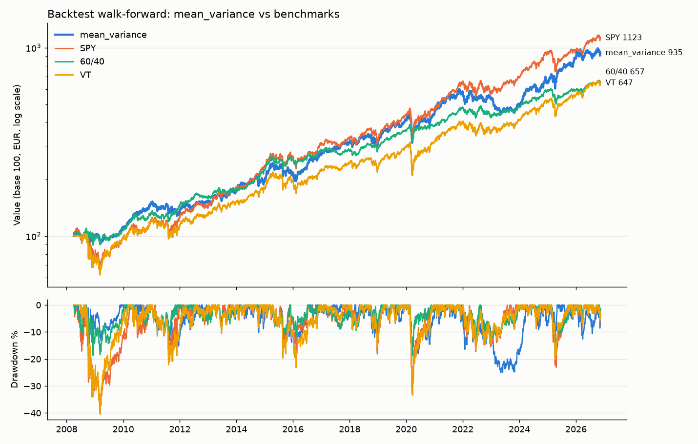
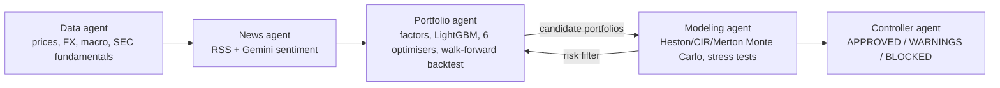
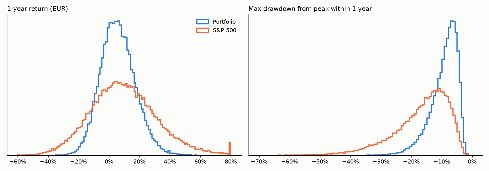

# Investment Agents

A multi-agent research pipeline for a diversified, long-only portfolio (stocks and ETFs, no derivatives), built for a small EUR-denominated account. Five agents run every evening: they collect market data and news, select and size the portfolio with factor models and machine learning, stress-test it with 1,000,000 Monte Carlo paths, and approve or block the proposal against configurable risk limits.

> Research project. It produces proposals and reports; it never places orders. Not investment advice.



## Pipeline



| Agent | What it does | Main techniques |
|---|---|---|
| Data | ~1,500 assets (S&P 500, Europe, Italy, Asia, EM, sector/factor/country ETFs, bonds, commodities, FX, alternatives, crypto) from 2005, converted to EUR; 15 FRED macro series; SEC XBRL fundamentals | point-in-time fundamentals (first filing date), synthetic pre-inception history for recent ETFs |
| News | Google News RSS on 8 themes, classified by Gemini into tickers, sentiment, impact and horizon | schema-constrained JSON output, impact-weighted sentiment with exponential decay |
| Portfolio | Scores, selects and optimises the portfolio; runs a walk-forward backtest of 6 methods since 2008 | 16 factors with IC-weighted adaptive weights, two LightGBM models (selection and expected returns), correlation clustering, Ledoit-Wolf + DCC covariance, SLSQP with analytic gradients, Rockafellar-Uryasev CVaR LP |
| Modeling | Simulates the proposal and every candidate method; replays crises | 8 correlated Heston factors (Andersen QE scheme), CIR 10-year yield, Merton jumps, calm/crisis regimes, multiprocessing (1M paths in ~4 min on a laptop) |
| Controller | Checks the proposal against hard and soft limits | Monte Carlo CVaR and drawdown probability, historical and hypothetical stress losses, constraint breaches, negative news |

## How simulations drive decisions
1. **In the backtest**: at every rebalance the Heston model is recalibrated on data up to that date and generates 10,000 three-month scenarios per asset. The CVaR cap and the `min_cvar` optimiser use these scenarios.
2. **Method selection today**: each of the 6 candidate portfolios is simulated with 200,000 one-year paths; methods breaching the CVaR or drawdown-probability limits are rejected, and the best backtest score among the remaining ones wins.
3. **Final check**: the controller blocks the proposal if the 1,000,000-path simulation or the stress tests breach the hard limits.

## Results
Walk-forward backtest, EUR, net of costs (10 bp per trade + EUR 1 per order on a EUR 5,000 account), quarterly rebalancing. Annualised returns, except the 1-year column.

| Strategy | 1y | 2y | 5y | since 2014 | since 2008 | Vol | Sharpe | Max DD |
|---|---|---|---|---|---|---|---|---|
| mean_variance (LightGBM expected returns) | +18.2% | +16.2% | +11.0% | +13.6% | +12.3% | 15.1% | 0.85 | -32% |
| max_sharpe | +12.9% | +7.8% | +7.3% | +12.0% | +10.5% | 12.6% | 0.85 | -27% |
| max_diversification | +9.0% | +3.1% | +4.8% | +15.6% | +12.3% | 15.5% | 0.82 | -28% |
| min_cvar | +13.3% | +7.5% | +6.0% | +7.2% | +7.7% | 11.9% | 0.68 | -22% |
| S&P 500 (SPY, in EUR) | +18.8% | +9.0% | +11.5% | +14.7% | +13.4% | 20.9% | 0.71 | -40% |
| 60/40 (SPY/IEF) | +11.2% | +5.0% | +6.7% | +10.4% | +10.3% | 14.5% | 0.75 | -19% |

Crisis windows: 2008-09 GFC `mean_variance` -9.9% vs S&P 500 -39.0%; Covid 2020 -30.1% vs -32.5%; 2022 -10.3% vs -11.3%.

**How parameters were chosen.** LightGBM hyper-parameters were selected with expanding-window validation on 2011-2013 (out-of-sample rank IC 0.070); the forecast blend and risk aversion of `mean_variance` were chosen on 2008-2013. **2014 onwards is out of sample** for these choices. In the full backtest the expected-return model has a mean out-of-sample IC of 0.065, positive on 73% of dates.

**Experiments that did not survive validation** (kept as switchable options and documented in [docs/experiments.md](docs/experiments.md)): a signal-based defensive regime switch (beat the offensive profile on 2008-2016 but not on 2017-2026), restricting single stocks to companies with SEC fundamentals, a core-satellite overlay, and HMM regime profiles.

### Known limitations
- **Survivorship bias**: the S&P 500 list is today's constituents, which flatters US equities in the backtest.
- **Fundamentals** cover US companies only (SEC); news has no history, so it only affects the live portfolio.
- **Synthetic histories** for recent capital-efficient ETFs are reconstructions (validated against real prices: correlation 0.92-0.99 for most, weaker for RSBT).
- **US-domiciled ETFs** are not available to EU retail investors (PRIIPs); UCITS equivalents are needed in practice.
- Every choice made after looking at results increases overfitting risk; this is why calibration and validation periods are separated.



## Quick start
```bash
git clone https://github.com/JacopoDePietro/investment-agents.git && cd investment-agents
python3.11 -m venv .venv && .venv/bin/pip install -r requirements.txt
cp .env.example .env            # optional: Gemini API key for the news agent
.venv/bin/python run.py data    # first download (~6 min, ~200 MB in data/)
.venv/bin/python run.py         # full pipeline: data, news, portfolio, modeling, controller
```
- Single agents: `run.py portfolio`, `run.py modeling`, ... (the portfolio backtest takes ~40 min the first time; the factor panel is then cached).
- Optional: `tools/tune_ml.py` re-runs the LightGBM hyper-parameter search (the tuned values are already in `config/settings.yaml`).
- Nightly schedule on macOS: `scheduler/install.sh` (Linux: cron, see the script header).
- Reports are written as Markdown notes to `vault/` (open the folder as an [Obsidian](https://obsidian.md) vault, or read them with any Markdown viewer).
- Analysis notebooks per agent: `notebooks/01_data.ipynb` … `05_controller.ipynb`.

## Configuration
Everything is in [`config/settings.yaml`](config/settings.yaml) (universe in [`config/universe.yaml`](config/universe.yaml)). Effective portfolio limits are layered: base values → risk profile (`growth`) → risk mode (`offense`). See [docs/architecture.md](docs/architecture.md) for the full parameter reference.

The modeling agent ships with its own implementation of the Andersen QE scheme, Merton jumps and the first-passage formula ([`agents/modeling_agent/sde.py`](agents/modeling_agent/sde.py)). Set `modeling.cflib_path` to use an external library exposing the same interfaces.

## Project structure
```
agents/
  data_agent/        universe, Yahoo/FRED/SEC downloads, quality checks
  news_agent/        RSS collection, Gemini classification, sentiment signals
  portfolio_agent/   factors, LightGBM models, selection, optimisers, backtest, regimes
  modeling_agent/    calibration, Monte Carlo, stress tests, scenarios for the optimiser
  controller_agent/  approval rules
core/                config, currency conversion, metrics, synthetic history, Markdown notes
tools/               experiment runner, LightGBM tuning, risk-mode calibration, notebook generator
notebooks/           per-agent analysis
docs/                architecture, agent documentation, experiment log
```

## Documentation
- [Architecture and parameter reference](docs/architecture.md)
- Agents: [data](docs/agents/data_agent.md) · [news](docs/agents/news_agent.md) · [portfolio](docs/agents/portfolio_agent.md) · [modeling](docs/agents/modeling_agent.md) · [controller](docs/agents/controller_agent.md)
- [Experiment log](docs/experiments.md)

## Data sources
Yahoo Finance (via `yfinance`), FRED, SEC EDGAR XBRL API, Google News RSS, Google Gemini API. Downloaded data is not redistributed in this repository; check each provider's terms of use.

## License
MIT, see [LICENSE](LICENSE).
